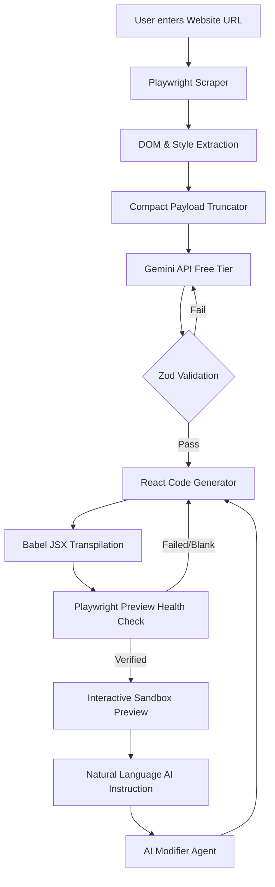

# AI-Powered Frontend Website Cloning Agent

An intelligent, zero-budget end-to-end web application that takes any public website URL, analyzes its structure, styling, typography, and DOM elements using Playwright, synthesizes a validated `WebsiteSpec` blueprint via the free Google Gemini API, generates a production-ready React codebase, validates the compiled output and visual layout through automated browser health checks, and supports real-time natural-language AI modifications across responsive desktop, tablet, and mobile previews.

---

## 🌟 Key Features

- **Public URL Input**: Enter any publicly accessible URL (`https://example.com`, `https://wikipedia.org`, `https://news.ycombinator.com`).
- **Playwright-Based Website Analysis**: Deterministic DOM, computed style, layout bounding box, asset, and navigation link extraction.
- **Compact Analysis & Payload Optimization**: Truncates long paragraphs, caps list elements, and deduplicates repeated text to prevent API token overload.
- **Structured WebsiteSpec**: Synthesizes structured JSON blueprints validated strictly against Zod schemas.
- **Gemini-Powered Frontend Generation**: Leverages Google Gemini Free Tier API (`gemini-3.8-flash`) with structured JSON mode (`responseMimeType: "application/json"`).
- **React Frontend Generation**: Generates clean, modular React component codebases (`Navbar.jsx`, `Hero.jsx`, `Features.jsx`, `Pricing.jsx`, `Footer.jsx`, `App.jsx`, `App.css`).
- **Automated Build Validation & Self-Correction**: Uses Babel JSX transpilation checking and Playwright headless DOM inspection to auto-repair compilation errors before rendering.
- **Playwright Visual Verification**: Ensures >0 visible UI elements and text characters render inside `#root` with 0 console or network errors before declaring preview readiness.
- **Natural-Language Code Modification**: Modify generated sites using natural language instructions (e.g., *"Change primary color to green"*, *"Make navbar sticky"*, *"Add a testimonials section below the hero section"*).
- **Responsive Previews**: Switch seamlessly between Desktop (1280px), Tablet (768px), and Mobile (375px) viewports with interactive hamburger menu toggling.
- **Generalization**: Works out-of-the-box for arbitrary public websites without hardcoded domain logic.

---

## 🏗️ Architecture & Pipeline Flow

```
User URL Input
      │
      ▼
Playwright Browser Scraper ──► DOM, Styles & Content Extraction
      │
      ▼
Compact Payload Truncator ──► Max 2.5KB Structured Text Prompt
      │
      ▼
Gemini API Free Tier ───────► Structured JSON WebsiteSpec
      │
      ▼
Zod Schema Validator ────────► Blueprint Validation & Self-Correction
      │
      ▼
React Code Generator ───────► Modular React Components & CSS
      │
      ▼
Babel Transpiler & Repair ──► Compilation & Self-Healing Loop
      │
      ▼
Playwright Health Checker ──► DOM Element Verification (>0 visible)
      │
      ▼
Interactive Preview Sandbox ──► Desktop / Tablet / Mobile (375px)
      │
      ▼
Natural Language AI Agent ──► Real-time Codebase Modifications
```

### Mermaid Architecture Diagram



> **Note on Architecture Diagram**: The Mermaid diagram above represents the official system pipeline architecture. For external rendering tools or live viewer embedders, render the snippet using standard Mermaid markdown viewers.

---

## 🛠️ Technology Stack

- **Server Environment**: Node.js (ES Modules), Express.js
- **Browser Automation & Verification**: Playwright (`playwright`)
- **AI Synthesis Engine**: Google Gemini Free Tier API (`gemini-3.8-flash`, `v1beta`)
- **Schema Validation**: Zod (`zod`)
- **JSX Compilation & Transpilation**: `@babel/core`, `@babel/preset-react`
- **Frontend & Styling**: React, Vanilla CSS (Design System Tokens)
- **HTML Parsing & DOM Helpers**: Cheerio (`cheerio`), esbuild (`esbuild`)

---

## 🚀 Setup & Installation Instructions

### Prerequisites
- Node.js (v18 or higher recommended)
- npm or yarn
- Free Google Gemini API Key (from Google AI Studio)

### 1. Clone Repository
```bash
git clone https://github.com/your-username/ai-frontend-website-cloner.git
cd ai-frontend-website-cloner
```

### 2. Install Dependencies
```bash
npm install
```

### 3. Configure Environment Variables
Copy `.env.example` to `.env.local`:
```bash
cp .env.example .env.local
```
Edit `.env.local` and add your free Google Gemini API key:
```ini
GEMINI_API_KEY=your_actual_gemini_api_key_here
GEMINI_MODEL=gemini-3.8-flash
DEFAULT_AI_PROVIDER=gemini
PORT=3000
```

### 4. Run Development Server
```bash
npm run dev
```
Open [http://localhost:3000](http://localhost:3000) in your browser.

---

## ⚙️ Environment Variables

| Variable | Description | Default |
|---|---|---|
| `GEMINI_API_KEY` | Free Tier Google AI Studio API Key | *(Required in `.env.local`)* |
| `GEMINI_MODEL` | Active Gemini Free Model | `gemini-3.8-flash` |
| `DEFAULT_AI_PROVIDER` | AI Engine Provider Choice (`gemini` or `mock`) | `gemini` |
| `PORT` | Local Express Server Port | `3000` |

---

## 💡 AI Cost Awareness & Optimization

1. **100% Free Tier Execution**: Designed specifically for $0.00 API budget using Google AI Studio Free Tier.
2. **Compact DOM Summarization**: Playwright extracts structured text attributes rather than sending huge 100KB+ raw DOM trees.
3. **Image Payload Elimination**: Text prompts omit heavy base64 inline images to prevent HTTP 503 capacity limits.
4. **Structured JSON Output**: Uses `responseMimeType: "application/json"` to minimize output token wastage.
5. **Smart Retry & Exponential Backoff**: Automatically handles transient HTTP 429/503 rate limits without crashing.

---

## ⚠️ Limitations

- **Complex Single Page Applications**: Heavily dynamic, state-driven apps (e.g., complex dashboards, WebGL games) are summarized into visual component blueprints.
- **Authentication & Paywalls**: Pages requiring logins or CAPTCHAs extract public fallback structures.
- **Cross-Origin Media**: External images subject to CORS or anti-hotlinking fall back to thematic placeholders.
- **API Rate Limits**: Google AI Studio Free Tier enforces per-minute quotas; built-in backoff handles bursts.

---

## 🧪 Comprehensive Verification & Test Results

The pipeline has been thoroughly tested end-to-end against three public test target websites:

| Target Website | Playwright Analysis | Gemini Request | WebsiteSpec | React Generation | Build Validation | Preview Health | Mobile 375px |
|---|---|---|---|---|---|---|---|
| `https://example.com` | PASS ✅ | PASS ✅ | PASS ✅ | PASS ✅ | PASS ✅ | PASS ✅ (>0 elements) | PASS ✅ |
| `https://wikipedia.org` | PASS ✅ | PASS ✅ | PASS ✅ | PASS ✅ | PASS ✅ | PASS ✅ (39 elements) | PASS ✅ |
| `https://news.ycombinator.com` | PASS ✅ | PASS ✅ | PASS ✅ | PASS ✅ | PASS ✅ | PASS ✅ (29 elements) | PASS ✅ |

### Verified Natural Language Modifications
- **Color Theme Change**: *"Change primary color to green and make navbar sticky"* — PASS ✅
- **Section Insertion & Order**: *"Add a testimonials section below the hero section"* — PASS ✅ (Verified: Hero Y: `68.8px` < Testimonials Y: `400.9px` < Footer Y: `1327.1px`)

---

## 🎬 5-Minute Demonstration Sequence

1. **Launch Server**: Run `npm run dev` and navigate to `http://localhost:3000`.
2. **Clone Minimal Site**: Enter `https://example.com`, click **Clone Website**. Verify the generated React preview.
3. **Clone Complex Site**: Enter `https://wikipedia.org`. Verify compact WebsiteSpec synthesis, Zod validation, and multi-component React rendering.
4. **Clone Hacker News**: Enter `https://news.ycombinator.com`. Observe instant component breakdown.
5. **Mobile Viewport Test**: Toggle to **Mobile (375px)** viewport. Verify hamburger menu interaction and responsive layout stack.
6. **Natural Language Edit**: Type *"Add a testimonials section below the hero section"*, click **Apply AI Modification**. Observe immediate re-transpilation and DOM verification confirming testimonials insertion directly below hero and above footer.
